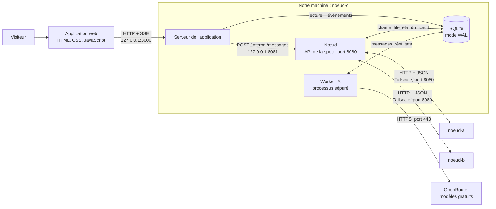

# Dossier de binôme

| Champ | Valeur |
| --- | --- |
| Binôme | **n°3** · Dylan Belledent, Nicolas Rapuzzi--Pisarczyk |
| Nœud | `noeud-c` (spec commune, décision 7) |
| Version du dossier | 0.4 (corrigé après relecture) · 23/11/2026 |
| Rendu | Vendredi 27/11/2026, 17h. Cette version `.md` reste dans Git ; l'export PDF (avec le schéma d'architecture) viendra plus tard. |
| S'appuie sur | [spec-commune.md](spec-commune.md) **v1.0** (validée par les six), [04-charte-editoriale.md](04-charte-editoriale.md), [05-bible-da.md](05-bible-da.md) |

> Plan de construction de notre projet. Il s'appuie sur la spec commune et ne la recopie pas : on écrit « voir spec §x ». Rien ne doit contredire la spec ni la bible DA.
> **Test :** un autre binôme doit pouvoir reprendre le projet avec ce seul document.

**Légende.** **[PROPOSITION]** : choix écrit pour rendre le dossier concret, à valider à deux (et avec la bible DA pour tout ce qui est visuel). **[À RÉPARTIR]** : à décider entre nous avant vendredi.

---

## 1. Le projet en bref

- **Notre regard** **[PROPOSITION]** : *une météo collective.* Chaque message est un temps qui passe sur un paysage commun : un message calme et froid fait naître une onde lente et bleue, un message vif et chaleureux une gerbe orange. La chaîne est le ciel que tout le monde remplit, l'œuvre est ce qu'il en reste. À remplacer par l'intention de la bible DA (section 1) si elle diffère.
- **Notre application :** une page web où un visiteur écrit un message de 280 caractères au plus, voit son état (en attente, dans un bloc, confirmé) et regarde l'œuvre évoluer en direct.
- **Notre œuvre :** une visualisation générative en temps réel, construite à partir des valeurs que l'IA tire de chaque message de la chaîne. L'œuvre vide est l'état de départ.
- **Notre nœud :** `noeud-c`, un programme qui garde une copie de la chaîne, applique les règles de la spec et parle aux deux autres nœuds.

## 2. L'architecture

Trois processus sur la même machine, qui ne se partagent que le fichier SQLite et une petite API locale :



| Composant | Rôle | Où il tourne | Comment il parle aux autres |
| --- | --- | --- | --- |
| Application web | Saisie, état d'un message, rendu de l'œuvre | Navigateur du visiteur | HTTP et flux SSE vers le serveur de l'application |
| Serveur de l'application | Sert la page, expose l'état des messages, la chaîne locale et les valeurs de l'IA, relaie les événements en SSE | Processus 1, **127.0.0.1:3000** | Lit SQLite ; appelle l'API interne du nœud pour écrire un message |
| Nœud | Valide, signe, stocke, produit les blocs, applique le consensus : implémente la spec | Processus 2, **port 8080** (tailnet) et **127.0.0.1:8081** (API interne) | HTTP + JSON vers `noeud-a` et `noeud-b` (spec §6) ; écrit dans SQLite |
| Worker IA | Appelle l'IA pour chaque message entré dans la chaîne | Processus 3, séparé du nœud | Lit et écrit SQLite ; HTTPS vers OpenRouter |
| SQLite | Chaîne, messages, état du nœud, résultats IA, événements | Fichier local `data/node.db`, hors Git, mode WAL | Partagé par les trois processus |
| OpenRouter | Modèles gratuits | Internet (port 443, autorisé par eduroam) | Reçoit le prompt, renvoie les valeurs et le nom du modèle |

**Pourquoi trois processus.** Le nœud a des contraintes de temps (créneau de 20 s, production entre 2 s et 15 s, spec §4.2). Un plantage ou un blocage du traitement IA ne doit jamais vider un créneau : le worker est donc à part, et le nœud ne l'attend jamais. Un petit script de lancement les démarre et les relance s'ils s'arrêtent.

**Deux interfaces locales, un seul port ouvert aux autres.** Seul le port 8080 est joignable depuis le tailnet : c'est celui de la spec. Le nœud l'écoute **sur l'adresse Tailscale de la machine** (100.x.y.z), pas sur toutes les interfaces, pour qu'il ne soit pas visible sur eduroam ou sur un autre réseau. Le serveur de l'application écoute sur 127.0.0.1 pour ne pas être joignable depuis Tailscale, et l'API interne du nœud aussi. Si on veut un jour que d'autres personnes écrivent depuis leur machine, on liera 3000 à l'adresse Tailscale, mais pas avant que ce soit nécessaire.

**Le navigateur ne lit jamais la base.** Il parle au serveur de l'application, qui lit SQLite et lui renvoie les états et les événements.

## 3. Le parcours d'un message

1. **Écriture.** Le visiteur saisit son texte. L'application envoie `POST /api/messages` avec `{content}` au serveur de l'application, qui le transmet à l'API interne du nœud (`POST /internal/messages`).
2. **Contrôle d'entrée.** Le nœud applique d'abord notre modération (charte éditoriale), met `content` en NFC et refuse ce qui sort de la spec §2.1 (longueur, caractères interdits, espaces en bordure). Il répond tout de suite au visiteur en cas de refus.
3. **Signature.** Le nœud fixe `timestamp` (strictement croissant, spec §2.1), calcule l'`id` (texte à barres, spec §2.1) et signe avec sa clé privée (lue dans `.env`).
4. **File et relais.** Le message entre dans la file (état `en_attente`) et est envoyé tout de suite aux deux autres nœuds par `POST /messages` (spec §6.4). Le visiteur reçoit l'`id` et voit « en attente ».
5. **Production du bloc.** À notre créneau, le nœud produit seulement si **toutes** les conditions de spec §4.2 sont réunies. Ce qui est propre à notre nœud : une minuterie vérifie le créneau chaque seconde, le créneau signé est écrit dans `node_state` avant la signature, et la vérification des pairs ne dépend jamais du worker IA. Sinon un autre nœud produit, et on reçoit le bloc par `POST /blocks`.
6. **Entrée dans la chaîne.** Dès qu'un message est dans un bloc de notre chaîne, son état passe à `dans_un_bloc` et un événement `message_state` prévient l'application. Il passe à `confirme` **[PROPOSITION]** dès que l'une des deux conditions est remplie : 3 blocs de plus ont été ajoutés (spec §5.3), **ou** la chaîne n'a pas changé depuis 60 s et les pairs joignables annoncent la même tête. La seconde condition est nécessaire, car la spec ne crée pas de bloc vide : sans elle, le dernier message d'une démonstration ne serait jamais confirmé.
7. **Traitement IA.** Le worker repère les messages `dans_un_bloc` qui n'ont pas de résultat, les prend par ordre d'index de bloc et en traite **2 en parallèle** **[PROPOSITION]**, pour qu'un message lent ne bloque pas les suivants. Il appelle OpenRouter avec notre prompt, valide la réponse et enregistre valeurs, modèle réel et statut (§5).
8. **Œuvre.** Le serveur envoie l'événement `values_ready`. La **position** d'un message dans l'œuvre vient de la chaîne (index du bloc puis position dans le bloc, jamais `timestamp`, spec §5.3) ; son **apparition** vient de l'arrivée de ses valeurs. Un message dont les valeurs arrivent en retard apparaît donc à sa place, mais plus tard.
9. **Fourche.** Si un bloc de notre chaîne disparaît ou change de place (spec §5.2), le nœud remet ses messages en file (état `remis_en_attente`) et émet un événement **`chain_reorganized`** avec l'index à partir duquel la chaîne a changé. L'application **reconstruit l'œuvre à partir de cet index** depuis la base. Les valeurs de l'IA restent valables : elles sont rattachées à l'`id` du message (spec §9).

**États d'un message :** `en_attente` → `dans_un_bloc` → `confirme`, avec `remis_en_attente` en cas de fourche (le message repart alors dans un bloc et retrouve `dans_un_bloc`).

## 4. Les données

SQLite, un fichier par nœud, en mode WAL (plusieurs processus). La chaîne est la source de vérité ; l'œuvre se reconstruit à partir de la **chaîne et des `ai_results`**. Sans les `ai_results`, rappeler le modèle donnerait d'autres valeurs : ils sont donc sauvegardés (voir plus bas).

| Table | Contenu | Pourquoi |
| --- | --- | --- |
| `blocks` | Un bloc complet par ligne (index, hash, previous_hash, producer, timestamp, messages_hash, signature) | Garder la chaîne sur disque (spec §7) |
| `messages` | `id`, `node`, `timestamp`, `content`, `signature`, `block_index` (vide si en file), `position`, `state` | Retrouver un message vite, suivre son état, tenir la file d'attente |
| `ai_results` | `message_id`, `block_index`, `model_requested`, `model_used`, `values` (JSON), `values_source` (`ia` ou `local`), `status`, `processed_at`, `prompt_version`, `raw_response` | Trace obligatoire de l'IA (spec §9) et justification à l'oral |
| `node_state` | État du nœud, voir ci-dessous | Exigé par la spec |
| `events` | Événements pour l'application (`message_state`, `values_ready`, `chain_reorganized`), avec un identifiant croissant | Le serveur de l'application les lit et les pousse en SSE (voir ci-dessous) |
| `peers_log` | Erreurs reçues des pairs (code, pair, date) | Débogage de la jonction |

**État du nœud (`node_state`), exigé par la spec :**

| Donnée | Pourquoi | Référence |
| --- | --- | --- |
| Dernier créneau signé, **écrit avant de signer** | Ne pas signer deux fois le même créneau après un redémarrage | spec §4.2 |
| Dernier `timestamp` de message émis | Rester strictement croissant après un redémarrage (sinon, dernier + 1) | spec §2.1 |
| Têtes ignorées (`tip_hash`, fin d'ignorance) | Une tête qui a échoué est ignorée 5 minutes | spec §7 |
| État `SYNCING` ou normal | Répondre `503` aux `POST` pendant un rattrapage | spec §7 |
| Dernier `/status` de chaque pair (heure, écart d'horloge) | Avertir au-delà de 2 s, savoir si un pair est joignable | spec §6.4 |

**Événements entre processus.** SQLite ne prévient pas les autres processus d'une écriture. Le serveur de l'application lit donc la table `events` **toutes les 500 ms** (`id > dernier id lu`). Chaque événement SSE porte cet `id` : après une coupure, le navigateur renvoie `Last-Event-ID` et reprend sans rien perdre.

**Accès concurrents.** Les trois processus ouvrent la base avec `busy_timeout = 5000` ms et gardent des transactions courtes (une écriture = une transaction). Le nœud ne garde jamais une transaction ouverte pendant un appel réseau, pour ne jamais échouer à écrire pendant son créneau.

**`values_source`, un ajout à la spec.** La spec §9 impose `status` (`ok`, `timeout`, `invalid_format`, `refused`). `values_source` (`ia` ou `local`) est un champ en plus, propre à notre binôme, qui ne contredit rien : il dit d'où viennent les valeurs utilisées par l'œuvre.

**Sauvegarde des `ai_results`.** Un export JSON complet de `ai_results` est écrit dans `data/exports/` toutes les 50 lignes et à l'arrêt du worker. Ces fichiers restent hors de Git (ils sont dans `data/`) ; chaque membre en garde une copie sur sa machine.

**Secrets.** Le fichier `.env` contient la graine privée du nœud et la clé OpenRouter. Il n'est jamais dans Git ; `.env.example` est vide.

**Pas de pseudo.** La spec v1.0 a retiré `author` (décision 1) : un message n'a ni auteur ni pseudo dans la chaîne, seulement le nœud d'entrée. Nous ne gardons pas non plus de pseudo dans notre base : il n'existerait que pour nos messages, pas pour ceux des autres nœuds.

## 5. L'IA

- **Quand :** une fois le message dans un bloc de notre chaîne, par le worker. Un message ne passe qu'une fois par l'IA (clé : `id`). Chaque nœud traite **tous** les messages de la chaîne, pas seulement les siens.
- **Modèle :** `openrouter/free` (accepté à condition d'enregistrer `model_used`, le modèle qui a réellement répondu). **[PROPOSITION]** si les réponses sont trop instables, fixer un modèle gratuit précis.
- **Prompt :** décrit dans la [charte éditoriale](04-charte-editoriale.md) (valeurs, bornes, format JSON), versionné (`prompt_version`).
- **Réponse attendue :** un objet JSON avec les valeurs de la section 6, chacune dans sa plage. On vérifie le format avant d'enregistrer.
- **Clé d'API :** une par personne d'après le sujet. Le nœud utilise la clé de la personne qui le fait tourner ; l'autre membre utilise la sienne dans son `.env` pour développer.
- **Débit :** chaque nœud traite tous les messages de la chaîne, donc la charge d'un test à trois est triple. Le worker applique un **plafond d'appels par minute** (`IA_MAX_PER_MINUTE`, 10 par défaut **[PROPOSITION]**) et traite 2 messages en parallèle au plus.
- **Quota journalier (le vrai plafond).** Nos comptes sont en offre **Free** d'OpenRouter : **50 requêtes par jour**, environ 25 modèles gratuits (page des tarifs d'OpenRouter, consultée le 23/11/2026). Ce plafond compte bien plus que le plafond par minute. Une heure d'usage réel à trois peut l'épuiser en quelques minutes. Le worker compte ses appels du jour (`IA_MAX_PER_DAY`) ; une fois le plafond atteint, il passe aux **valeurs locales de repli** jusqu'au lendemain, et l'œuvre le montre (voir §6). Pistes à décider : utiliser à tour de rôle les deux clés du binôme, demander à l'équipe enseignante si un crédit est autorisé.

| Situation | Ce que fait le worker |
| --- | --- |
| Pas de réponse ou réponse trop lente (plus de 20 s) | `status = timeout`, 3 essais avec délai croissant (2 s, 6 s, 18 s) |
| Réponse hors format (pas du JSON, valeur absente ou hors plage) | `status = invalid_format`, un nouvel essai avec un rappel du format |
| Quota par minute ou erreur 429 | Pause selon `Retry-After`, puis reprise dans l'ordre des index de bloc |
| Quota du jour atteint | Valeurs locales de repli jusqu'au lendemain, `values_source = local` |
| Refus du modèle | `status = refused` |
| Après les essais ratés | **Valeurs locales de repli** (ci-dessous), `values_source = local` |

**Valeurs locales de repli** **[PROPOSITION]** : calculées sans IA, de façon déterministe, à partir du texte : `energie` selon la part de `!` et de majuscules, `densite` selon la longueur sur 280, `chaleur` = 0,5, `theme` = `air`. L'œuvre reste vivante même si l'IA est coupée, et on voit dans la base quelles valeurs viennent de l'IA.

La chaîne n'est **jamais** touchée par une panne d'IA (spec §9).

## 6. Des valeurs à l'œuvre

**[PROPOSITION]** Ordre de travail : la [charte éditoriale](04-charte-editoriale.md) définit les valeurs, la [bible DA](05-bible-da.md) (section 6) les règles génératives ; cette section les **recopie à l'identique** une fois les deux documents écrits. Ce qui suit est le brouillon de départ.

**Valeurs tirées de chaque message :**

| Valeur | Type | Sens |
| --- | --- | --- |
| `energie` | nombre de 0 à 1 | calme (0) → agité (1) |
| `chaleur` | nombre de 0 à 1 | froid (0) → chaleureux (1) |
| `densite` | nombre de 0 à 1 | léger (0) → chargé (1) |
| `theme` | `eau`, `terre`, `feu` ou `air` | l'élément qui évoque le mieux le message |

Format de réponse attendu : `{"energie":0.2,"chaleur":0.3,"densite":0.6,"theme":"eau"}`.

**Règles génératives** (valeur → paramètre visuel) :

| Valeur | Paramètre visuel | Règle |
| --- | --- | --- |
| `energie` | Vitesse et amplitude du mouvement | De l'ondulation lente à la vibration rapide |
| `chaleur` | Teinte | `teinte = 210 − 190 × chaleur` (bleu à 0, orange à 1 ; passe par le vert et le jaune vers 0,5 : palette à valider avec la bible DA) |
| `densite` | Taille et opacité de la forme | Plus la densité est forte, plus la forme est grande et opaque |
| `theme` | Type de forme | `eau` : ondes concentriques ; `terre` : polygones ; `feu` : particules montantes ; `air` : traits fins |
| Position dans la chaîne | Emplacement | Spirale : l'angle suit l'index du bloc puis la position du message dans le bloc |
| `id` du message | Petites variations | Sert de graine aléatoire : le même message donne toujours le même dessin |

**Exemple.** Le message `Il pleut sur Béziers ce matin.` donne, par exemple, `{"energie":0.2,"chaleur":0.3,"densite":0.6,"theme":"eau"}`. L'œuvre ajoute des **ondes concentriques lentes**, de teinte `210 − 190 × 0,3 = 153°` (bleu-vert), assez grandes et opaques, placées sur la spirale à l'emplacement du bloc 1.

**Technique et fonctionnement :**
1. **Rendu :** Canvas 2D en JavaScript natif (aucune dépendance) **[PROPOSITION]**.
2. **Temps réel :** le serveur pousse les événements en SSE ; l'œuvre ajoute chaque message dans l'ordre de la chaîne.
3. **Déterminisme :** même chaîne et mêmes `ai_results` donnent la même image. Pour cela, aucun `Math.random` : un générateur pseudo-aléatoire est initialisé par l'`id` du message, et les positions sont calculées dans un repère normalisé (0 à 1), mis à l'échelle seulement au dessin. L'image ne dépend donc pas de la taille de l'écran.
4. **Reconstruction :** depuis la base (chaîne + `ai_results`), de l'index touché par un événement `chain_reorganized`, ou depuis le début au chargement de la page.
5. **États à prévoir :** œuvre vide, quelques messages, beaucoup de messages (esquisses de la bible DA, section 7).
6. **Beaucoup de messages** **[PROPOSITION]** : au-delà de 150 formes visibles, les plus anciennes **vieillissent** (opacité et taille qui baissent selon leur rang dans la chaîne) puis se fondent dans un fond qui garde la teinte moyenne. L'œuvre ne sature pas et garde la mémoire de tous les messages.
7. **Valeurs locales :** une forme dont `values_source = local` est dessinée en trait plus fin, pour que la panne d'IA se voie sans casser l'œuvre.

## 7. Les choix techniques

| Domaine | Choix **[PROPOSITION]** | Pourquoi | Écarté |
| --- | --- | --- | --- |
| Plateforme | **Node.js 24 LTS** (version de développement : 24.14.1) | SHA-256 et Ed25519 intégrés (`node:crypto`), `node:test`, `--env-file` | PHP (moins naturel pour un processus de fond), Python (pas de gain pour nous) |
| Serveurs HTTP | **Express 5** (nœud et serveur de l'application) | Connu, léger, bien documenté | `node:http` brut (plus de code à écrire), frameworks plus lourds |
| Stockage | **SQLite avec `better-sqlite3`**, mode WAL | Un seul fichier, API synchrone simple, plusieurs processus en lecture et écriture | `node:sqlite` (sans dépendance mais encore instable selon la version) ; MySQL/PostgreSQL (serveur à installer pour rien) ; fichiers JSON (écritures non sûres) |
| Processus | Trois processus relancés par un script maison | Isole le nœud des pannes de l'IA | Tout dans un seul processus (un plantage vide un créneau) |
| Application | HTML, CSS, JavaScript natifs | Cohérent avec le parcours développement web, aucune étape de build | React, Vue : inutile pour un écran |
| Rendu de l'œuvre | Canvas 2D | Contrôle total, pas de bibliothèque | p5.js (plus rapide à prototyper), WebGL (trop lourd) |
| Temps réel | SSE | Flux simple du serveur vers le navigateur | WebSocket (plus complexe pour un flux à sens unique) |
| Configuration | `node --env-file=.env` | Intégré, pas de bibliothèque `dotenv` | `dotenv` |
| Tests | `node:test` | Intégré | Jest, Mocha |
| Réseau, IA, code | Tailscale (port 8080), OpenRouter (modèles gratuits), GitHub privé | Imposés par le sujet | — |

Les langages sont libres selon le sujet. PHP et Python ont aussi SHA-256 et Ed25519 (spec, « ce qui n'est pas à décider ») : ce n'est donc pas ce qui nous fait choisir. Le vrai argument est **un seul langage pour le nœud, le worker, le serveur et l'œuvre** : JavaScript partout, un seul outillage, et du code partagé (calcul des `id`, tri des messages) entre le nœud et l'application.

## 8. Les tests

| Niveau | Comment | Quand |
| --- | --- | --- |
| **Nœud seul** | Tests automatiques qui rejouent les **26 cas** de la spec (§10.2) : `id`, `hash`, signatures, cas valides et invalides, règle de choix entre chaînes, tri des messages. Les entrées des 22 cas à produire sont partagées dans `tests/vectors/` du dépôt commun. **Notre part : les cas 20 à 26** (redémarrages, nœud isolé, file récupérée, `SAME_PRODUCER`, envoi raté, fourche de même hauteur), à déposer **avant le lundi 07/12 au soir** | Nos entrées : dès que l'équipe enseignante confirme que préparer des vecteurs en S49 (semaine sans SAÉ, code prévu en S50) est accepté, sinon lundi 07/12. **Palier 1 (07/12, sans réseau)** : les cas hors réseau (1 à 14, 17 à 19, 22). **Paliers 2 et 3** : les cas en direct sur le réseau (15, 16, 20, 21, 23 à 26) |
| **Nœud avec les deux autres** | Essais deux à deux puis à trois : messages, blocs, fourche, coupure d'un nœud, redémarrage des trois (§10.3, paliers 2 et 3) | Mercredi 09/12 puis jeudi 10/12 |
| **Application de bout en bout** | Un message écrit dans l'application passe par `en_attente`, `dans_un_bloc`, `confirme`, reçoit des valeurs de l'IA et modifie l'œuvre | Fin de S50 |
| **Fourche et œuvre** | Provoquer une fourche en test : l'événement `chain_reorganized` reconstruit l'œuvre sans message perdu ni doublon | S50 |
| **IA** | Appel réel d'OpenRouter sur 10 messages types (charte) ; IA simulée pour les pannes (timeout, hors format, quota) ; vérifier que le plafond d'appels par minute est respecté | S50 |
| **Plantage du worker** | Arrêter le worker pendant un créneau : le nœud produit quand même son bloc | S50 |
| **Œuvre** | Rejouer une base de messages de test : œuvre vide, quelques messages, beaucoup | S50 et S2 |

Critère de fin : tous les cas de la spec passent, trois chaînes ont le même hash de tête après une minute, et l'œuvre se reconstruit à partir de la base (chaîne + `ai_results`) en donnant la même image.

## 9. Les risques

| Risque | Gravité | Ce que nous prévoyons |
| --- | --- | --- |
| Un nœud n'est pas compatible avec la spec | Haute | Rejouer les cas hors réseau le 07/12, les cas en direct les 09 et 10/12 ; si deux lectures divergent, corriger la spec avant le code |
| Quota OpenRouter du jour épuisé (offre Free : 50 requêtes par jour, et chaque nœud traite tous les messages) | Haute | Compteur journalier, valeurs locales de repli ; question posée à l'équipe sur l'usage des deux clés du binôme ou d'un crédit |
| Verrou SQLite : le nœud n'arrive pas à écrire pendant son créneau | Moyenne | `busy_timeout`, transactions courtes, jamais de transaction ouverte pendant un appel réseau |
| Un portable se met en veille ou redémarre (mise à jour Windows) | Moyenne | Branché sur secteur, veille désactivée, mises à jour suspendues la semaine du 07/12 ; vérifié au début du jour J |
| `better-sqlite3` ne s'installe pas (pas de binaire précompilé pour notre version de Node sous Windows) | Moyenne | `npm install` testé sur les deux machines dès S49 ; sinon outils de compilation ou `node:sqlite` |
| Spec encore modifiée après jeudi | Haute | Une seule version de référence, citée par son numéro ; changements par accord des trois binômes ; gel au 07/12 |
| IA gratuite lente, en panne ou limitée | Moyenne | Plafond d'appels par minute, essais et statuts (§5), valeurs locales de repli, IA simulée en test |
| Le traitement IA fait tomber le nœud pendant un créneau | Haute | Worker dans un processus séparé, relancé automatiquement ; le nœud ne l'attend jamais |
| Perte des `ai_results` (l'œuvre ne se reconstruirait pas à l'identique) | Moyenne | Export JSON régulier dans `data/exports/`, copie sur la machine de l'autre membre |
| Clé privée ou clé OpenRouter publiée par erreur dans Git | Haute | `.gitignore` (`.env`), `.env.example` vide, relecture avant chaque push, masquage des clés dans les prompts enregistrés |
| Horloges des PC différentes | Moyenne | Synchronisation automatique, avertissement au-delà de 2 s (spec §6.4) |
| Réseau Tailscale ou eduroam instable en salle | Moyenne | Préparer l'environnement chez soi en S49, tester la liaison avant le 10/12, garder des tests locaux sans réseau |
| Retard de l'un des deux | Moyenne | Backlog partagé, daily chaque matin, tâches petites, relecture croisée |
| Travail inégal dans le binôme | Moyenne | Répartition nominative (section 10), journal de bord, chacun comprend tout le code (oral individuel) |
| L'export PDF du schéma Mermaid ne marche pas | Moyenne | Tester l'export (image du schéma) dès jeudi 26/11, bien avant vendredi 17h |
| Trop d'ambition pour l'œuvre | Moyenne | D'abord une version minimale qui marche de bout en bout, puis enrichir |

## 10. L'organisation

**Qui fait quoi** **[À RÉPARTIR]** : la liste des domaines est établie ; le sujet attend une répartition **nominative** dans le dossier, donc à trancher à deux **au plus tard mercredi 25/11**.

| Domaine | Contenu | Responsable | Relecteur |
| --- | --- | --- | --- |
| Nœud | Validation, production des blocs, consensus, échanges avec les pairs (spec) | à répartir | à répartir |
| Application | Saisie d'un message, suivi de son état, affichage de la chaîne | à répartir | à répartir |
| IA | Prompt, worker, gestion des pannes, trace en base | à répartir | à répartir |
| Œuvre | Rendu génératif, lien avec la bible DA | à répartir | à répartir |
| Tests | Vecteurs de la spec, tests du nœud, de l'IA et de bout en bout | à répartir | à répartir |
| Intégration | Jonction avec les deux autres nœuds, essais à deux puis à trois | à deux | à deux |
| Documents | Charte éditoriale, bible DA, backlog, journal, dossier | à répartir | à répartir |

Règle déjà fixée : chacun relit le travail de l'autre, pour que chacun puisse expliquer **tout** le projet à l'oral.

**Comment nous travaillons à deux :**
- Daily chaque matin (10 minutes avec l'enseignant), puis un point rapide entre nous à midi.
- Journal de bord dans [journal.md](journal.md), décisions dans [decisions.md](decisions.md).
- Backlog dans [06-backlog.md](06-backlog.md), avec estimation et responsable.

**Git :**
- Dépôt GitHub privé, accès donné **aux deux membres du binôme et à l'équipe enseignante**.
- Personne ne pousse directement sur `main` : une branche par tâche (`feat/...`, `fix/...`), fusion par pull request relue par l'autre. Si l'offre GitHub gratuite ne permet pas de verrouiller la branche sur un dépôt privé, c'est une règle d'équipe, pas un blocage technique.
- Messages de commit courts et clairs, un sujet par commit.
- Jamais de secret dans Git (`.env`, clés).
- **La spec :** la référence est la spec des six, dans un dépôt GitHub privé commun (décision 14 ; création prévue le 27/11, point ouvert O1). La copie `docs/spec-commune.md` de ce dépôt est la v1.0 et ne se modifie jamais seule : tout changement passe par une pull request approuvée par les trois binômes (spec §11).

**IA pour coder** (autorisée par le sujet) :
- Nous utilisons un assistant de code (Claude Code). Les prompts sont enregistrés automatiquement dans `docs/prompts/` (clés masquées) : cela donne une trace de notre usage.
- Règles : on relit et on comprend chaque morceau de code avant de le garder ; on teste ce que l'IA écrit ; l'IA propose, nous décidons et justifions dans `decisions.md`.
- À l'oral, chacun explique tout, y compris ce que l'IA a aidé à écrire.

**Structure du dépôt prévue :**

```
.
├── README.md
├── docs/               documents du projet (ce dossier, spec, journal, backlog...)
├── node/               le nœud (spec) : chaîne, validation, échanges, API interne
├── worker/             le worker IA
├── app/                serveur de l'application, page web et œuvre
├── scripts/            lancement des trois processus, génération de la clé
├── tests/              vecteurs de la spec et tests
├── data/               base SQLite et exports (hors Git)
└── .env.example        modèle de configuration, sans secret
```

## 11. Démarrer le projet

Ces commandes décrivent l'état visé **[PROPOSITION]** : elles seront confirmées quand le code existera (S50).

**Prérequis :**
- Node.js **24 LTS** et npm, Git.
- Tailscale installé et rejoint au tailnet de la SAÉ (clé sur Moodle, jamais dans Git) :
  `tailscale up --hostname=noeud-c`, puis connexion par le lien affiché. Si on utilise `--auth-key=<clé>`, la clé reste dans l'historique du terminal : l'effacer ensuite (ou la lire depuis une variable d'environnement).
- Un compte OpenRouter et une clé d'API (modèles gratuits uniquement).

**Installer et lancer :**

```powershell
git clone <url du dépôt>
cd <dossier>
npm install
copy .env.example .env
npm run keygen      # génère la graine du nœud et affiche la clé publique (à publier aux six avant le lundi 07/12, point ouvert O3)
npm start           # lance le nœud, le worker et le serveur de l'application
npm test            # rejoue les cas de la spec
```

Puis ouvrir `http://127.0.0.1:3000`.

**Variables du fichier `.env` :**

| Variable | Rôle | Exemple |
| --- | --- | --- |
| `NODE_ID` | Identifiant du nœud (spec) | `noeud-c` |
| `NODE_SEED_HEX` | Graine privée Ed25519 (secrète) | 64 caractères hexadécimaux |
| `PEERS` | Pairs et leur port ; adresses IP Tailscale si les noms ne sont pas résolus (spec décision 13) | `noeud-a:8080,noeud-b:8080` ou `100.x.y.z:8080,...` |
| `HOST_NODE` | Adresse d'écoute de l'API de la spec : l'IP Tailscale de la machine | `100.x.y.z` |
| `PORT_NODE` | Port de l'API de la spec (tailnet) | `8080` |
| `PORT_INTERNAL` | API interne, 127.0.0.1 | `8081` |
| `PORT_APP` | Serveur de l'application, 127.0.0.1 | `3000` |
| `DB_PATH` | Fichier SQLite | `data/node.db` |
| `OPENROUTER_API_KEY` | Clé OpenRouter (secrète) | `sk-or-...` |
| `OPENROUTER_MODEL` | Modèle demandé | `openrouter/free` |
| `IA_MAX_PER_MINUTE` | Plafond d'appels par minute | `10` |
| `IA_MAX_PER_DAY` | Plafond d'appels par jour, puis valeurs locales | `50` (offre Free) |

**Ports :** 8080 (spec, sur l'IP Tailscale), 8081 et 3000 (locaux, 127.0.0.1).

**Si quelque chose ne marche pas :** `tailscale status` doit lister les autres nœuds ; `GET http://noeud-a:8080/api/v1/status` doit répondre ; l'heure de l'ordinateur doit être synchronisée automatiquement.
