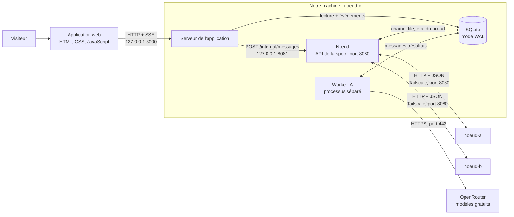

# Dossier de binôme

| Champ | Valeur |
| --- | --- |
| Binôme | **n°3** · Dylan Belledent, Nicolas Rapuzzi--Pisarczyk |
| Nœud | `noeud-c` (spec commune, décision 7) |
| Version du dossier | 0.14 (spec commune **v1.1 validée** par les trois binômes le 26/11/2026 ; bible DA v1.5) · 27/11/2026 · v0.13 (horloge, auto-vérification, chaînes d'essai et réelle, expéditeur) · 26/11/2026 · v0.12 (ruines optionnelles, brume réservée aux messages masqués : bible v1.3, charte v1.3) · 25/11/2026 · v0.11 (relief recalibré par simulation, D-025 ; lexique de 95 entrées) · 25/11/2026 · v0.10 : import map Three.js, risque prise en main 3D, déterminisme par empreinte de heightmap, balises forme + couleur |
| Rendu | PDF (schéma Mermaid exporté en image), vendredi 27/11/2026, 17h. |
| S'appuie sur | **spec commune v1.1** (validée par les trois binômes le 26/11/2026, remplace la v1.0), [04-charte-editoriale.md](04-charte-editoriale.md) v1.3, [05-bible-da.md](05-bible-da.md) v1.5 |

> Plan de construction de notre projet. Il s'appuie sur la spec commune et ne la recopie pas : on écrit « voir spec §x ». Rien ne doit contredire la spec ni la bible DA.
> **Test :** un autre binôme doit pouvoir reprendre le projet avec ce seul document.

---

## 1. Le projet en bref

- **Notre regard :** *une terre qui naît de nos mots*, et une œuvre qui s'appelle ***Terre commune***. Au départ, un océan vierge en 3D. Chaque message sculpte durablement une même carte procédurale (heightmap) et module l'atmosphère : la joie fait émerger des terres vertes, forêts et voiliers sous le soleil ; le calme façonne des criques et des phares ; la tristesse creuse des baies et des lagons sous la pluie et le brouillard ; la colère fait jaillir des volcans sous l'orage (intention complète : bible DA §1).
- **Notre application :** une page web où un visiteur écrit un message de 280 caractères au plus, voit son état (en attente, dans un bloc, confirmé) et regarde l'œuvre évoluer en direct.
- **Notre œuvre :** une visualisation générative en temps réel, construite à partir des valeurs que l'IA tire de chaque message de la chaîne. L'œuvre vide est l'état de départ.
- **Notre nœud :** `noeud-c`, un programme qui garde une copie de la chaîne, applique les règles de la spec et parle aux deux autres nœuds.

## 2. L'architecture

Trois processus sur la même machine, qui ne se partagent que le fichier SQLite et une petite API locale :



| Composant | Rôle | Où il tourne | Comment il parle aux autres |
| --- | --- | --- | --- |
| Application web | Saisie, état d'un message, rendu de l'œuvre | Navigateur du visiteur | HTTP et flux SSE vers le serveur de l'application |
| Serveur de l'application | Sert la page, expose l'état des messages, la chaîne locale et les valeurs de l'IA, relaie les événements en SSE | Processus 1, **127.0.0.1:3000** | Lit SQLite ; appelle l'API interne du nœud pour écrire un message |
| Nœud | Valide, signe, stocke, produit les blocs, applique le consensus : implémente la spec | Processus 2, **port 8080** (tailnet) et **127.0.0.1:8081** (API interne) | HTTP + JSON vers `noeud-a` et `noeud-b` (spec §6) ; écrit dans SQLite |
| Worker IA | Appelle l'IA pour chaque message entré dans la chaîne | Processus 3, séparé du nœud | Lit et écrit SQLite ; HTTPS vers OpenRouter |
| SQLite | Chaîne, messages, état du nœud, résultats IA, événements | Fichier local `data/node.db`, hors Git, mode WAL | Partagé par les trois processus |
| OpenRouter | Modèles gratuits | Internet (port 443, autorisé par eduroam) | Reçoit le prompt, renvoie les valeurs et le nom du modèle |

**Pourquoi trois processus.** Le nœud a des contraintes de temps (créneau de 20 s, production entre 2 s et 15 s, spec §4.2). Un plantage ou un blocage du traitement IA ne doit jamais vider un créneau : le worker est donc à part, et le nœud ne l'attend jamais. Un petit script de lancement les démarre et les relance s'ils s'arrêtent.

**Deux interfaces locales, un seul port ouvert aux autres.** Seul le port 8080 est joignable depuis le tailnet : c'est celui de la spec. Le nœud l'écoute **sur l'adresse Tailscale de la machine** (100.x.y.z), pas sur toutes les interfaces, pour qu'il ne soit pas visible sur eduroam ou sur un autre réseau. Le serveur de l'application écoute sur 127.0.0.1 pour ne pas être joignable depuis Tailscale, et l'API interne du nœud aussi.

**Qui peut écrire dans l'application.** eduroam isole les postes : aucun visiteur ne peut joindre notre PC directement.
- **Mode principal :** les visiteurs écrivent **sur notre PC** (ou sur un second écran branché dessus), à `http://127.0.0.1:3000`. C'est le plus simple et le plus sûr.
- **Variante prévue :** la variable `APP_HOST` lie le port 3000 à l'adresse Tailscale, pour que les membres du tailnet (les autres binômes, l'équipe enseignante) écrivent depuis leur machine. Elle n'est activée que pendant une démonstration.
- **Écarté :** exposer l'application sur internet. Un message ne s'efface jamais, et notre filtre (charte §4.1) ne suffit pas face à un accès ouvert à tous.

**Le navigateur ne lit jamais la base.** Il parle au serveur de l'application, qui lit SQLite et lui renvoie les états et les événements.

**Le masquage se fait côté serveur.** Pour un message masqué (charte §4.2), le serveur de l'application **retire `content`** de toutes ses réponses (chaîne, états, événements) : le texte n'arrive jamais au navigateur, même dans l'onglet réseau. Le serveur applique aussi au moment de l'affichage les mêmes règles que le filtre avant signature (e-mail, téléphone, lien, liste de mots) à **tous** les messages, y compris ceux des autres nœuds : c'est gratuit et ne dépend pas de l'IA.

## 3. Le parcours d'un message

1. **Écriture.** Le visiteur saisit son texte. L'application envoie `POST /api/messages` avec `{content}` au serveur de l'application, qui le transmet à l'API interne du nœud (`POST /internal/messages`).
2. **Contrôle d'entrée.** L'application retire d'abord les espaces au début et à la fin avant l'envoi (sans message, liste exacte de la spec §2.1, charte §4.1). Le nœud applique ensuite notre filtre avant signature (charte §4.1 : données personnelles, liste de mots, débit, sans appel à l'IA), met `content` en NFC et refuse ce qui sort de la spec §2.1 (longueur, caractères ou espaces résiduels interdits), ainsi que si son horloge est désynchronisée ou a reculé (spec §4.2 condition 8, §2.1 [M7]). Il répond tout de suite au visiteur en cas de refus.
3. **Signature.** Le nœud fixe `timestamp` (strictement croissant, spec §2.1), calcule l'`id` (texte à barres, spec §2.1) et signe avec sa clé privée (lue dans `.env`).
4. **File et relais.** Le message entre dans la file (état `en_attente`) et est envoyé tout de suite aux deux autres nœuds par `POST /messages` (spec §6.4). Le visiteur reçoit l'`id` et voit « en attente ».
5. **Production du bloc.** À notre créneau, le nœud produit seulement si **toutes** les conditions de spec §4.2 sont réunies. Ce qui est propre à notre nœud : une minuterie vérifie le créneau chaque seconde, le créneau signé est écrit dans `node_state` avant la signature, et la vérification des pairs ne dépend jamais du worker IA. **v1.1 :** le nœud ne produit pas si le créneau en cours n'est pas strictement après celui de la tête, ni si son horloge est à plus de 2 s de tous les pairs ; et il **valide son propre bloc** avec la même fonction que pour un bloc reçu (spec §3.2, règles 1 à 10) avant de l'ajouter à sa chaîne. Sinon un autre nœud produit, et on reçoit le bloc par `POST /blocks`.
6. **Entrée dans la chaîne.** Dès qu'un message est dans un bloc de notre chaîne, son état passe à `dans_un_bloc` et un événement `message_state` prévient l'application. Il passe à `confirme` dès que l'une des deux conditions est remplie : 3 blocs de plus ont été ajoutés (spec §5.3), **ou** la chaîne n'a pas changé depuis 60 s et les pairs joignables annoncent la même tête. La seconde condition est nécessaire, car la spec ne crée pas de bloc vide : sans elle, le dernier message d'une démonstration ne serait jamais confirmé.
7. **Traitement IA.** Le worker repère les messages `dans_un_bloc` qui n'ont pas de résultat, les prend par ordre d'index de bloc et les envoie **par lots dans une seule requête**, selon la règle de déclenchement du §5. Il appelle OpenRouter avec notre prompt, valide la réponse et enregistre valeurs, modèle réel et statut (§5).
8. **Œuvre.** Le serveur envoie l'événement `values_ready`. Le point d'impact d'un message sur la carte 3D vient de son rang dans la chaîne et de son `id` (jamais `timestamp`, spec §5.3 ; bible DA §6.1) ; un message sculpte le terrain **dès son entrée dans un bloc**, en **prévision** (valeurs locales, maillage filaire lumineux translucide), puis se solidifie en **observation** (matière définitive du biome) quand les valeurs de l'IA arrivent. L'œuvre n'attend donc jamais l'IA, et le quota rare devient visible.
9. **Fourche.** Si un bloc de notre chaîne disparaît ou change de place (spec §5.2), le nœud remet ses messages en file (état `remis_en_attente`) et émet un événement **`chain_reorganized`** avec l'index à partir duquel la chaîne a changé. L'application **reconstruit l'œuvre à partir de cet index** depuis la base. Les valeurs de l'IA restent valables : elles sont rattachées à l'`id` du message (spec §9).

**États d'un message :** `en_attente` → `dans_un_bloc` → `confirme`, avec `remis_en_attente` en cas de fourche (le message repart alors dans un bloc et retrouve `dans_un_bloc`).

## 4. Les données

SQLite, un fichier par nœud, en mode WAL (plusieurs processus). La chaîne est la source de vérité ; l'œuvre se reconstruit à partir de la **chaîne et des `ai_results`**. Sans les `ai_results`, rappeler le modèle donnerait d'autres valeurs : ils sont donc sauvegardés (voir plus bas).

| Table | Contenu | Pourquoi |
| --- | --- | --- |
| `blocks` | Un bloc complet par ligne (index, hash, previous_hash, producer, timestamp, messages_hash, signature) | Garder la chaîne sur disque (spec §7) |
| `messages` | `id`, `node`, `timestamp`, `content`, `signature`, `block_index` (vide si en file), `position`, `state` | Retrouver un message vite, suivre son état, tenir la file d'attente |
| `ai_results` | `message_id`, `block_index` (**mis à jour** si le message change de bloc après une fourche, spec §9 [I1]), `model_requested`, `model_used`, `values` (JSON, vide si la tentative a échoué), `status`, `processed_at`, `prompt_version`, `raw_response` | Trace obligatoire de l'IA (spec §9) et justification à l'oral. Une ligne par tentative ; **seules les valeurs de l'IA sont stockées**. La position affichée dans l'œuvre se lit toujours dans la chaîne actuelle (`blocks`/`messages`), jamais dans un `block_index` figé |
| `node_state` | État du nœud, voir ci-dessous | Exigé par la spec |
| `events` | Événements pour l'application (`message_state`, `values_ready`, `chain_reorganized`), avec un identifiant croissant | Le serveur de l'application les lit et les pousse en SSE (voir ci-dessous) |
| `peers_log` | Erreurs reçues des pairs (code, pair, date) | Débogage de la jonction |

**État du nœud (`node_state`), exigé par la spec :**

| Donnée | Pourquoi | Référence |
| --- | --- | --- |
| Dernier créneau signé, **écrit avant de signer** | Ne pas signer deux fois le même créneau après un redémarrage | spec §4.2 |
| Dernier `timestamp` de message émis | Rester strictement croissant après un redémarrage (sinon, dernier + 1) | spec §2.1 |
| Têtes ignorées (`tip_hash`, fin d'ignorance) | Une tête qui a échoué est ignorée 5 minutes | spec §7 |
| État `SYNCING` ou normal | Répondre `503` aux `POST` pendant un rattrapage | spec §7 |
| Dernier `/status` de chaque pair (heure, écart d'horloge) | Savoir si un pair est joignable ; au-delà de 2 s d'écart avec tous les pairs, ne plus produire ni signer et l'afficher dans la console (v1.1) | spec §4.2, §6.4 |
| Adresse IP Tailscale de chaque pair | Reconnaître l'expéditeur d'une requête : limites par pair, relais, journal (v1.1) | spec §6.1 |

**Événements entre processus.** SQLite ne prévient pas les autres processus d'une écriture. Le serveur de l'application lit donc la table `events` **toutes les 500 ms** (`id > dernier id lu`). Chaque événement SSE porte cet `id` : après une coupure, le navigateur renvoie `Last-Event-ID` et reprend sans rien perdre.

**Accès concurrents.** Les trois processus ouvrent la base avec `busy_timeout = 5000` ms et gardent des transactions courtes (une écriture = une transaction). Le nœud ne garde jamais une transaction ouverte pendant un appel réseau, pour ne jamais échouer à écrire pendant son créneau.

**`values_source`, un champ calculé, pas stocké.** La spec §9 impose `status` (`ok`, `timeout`, `invalid_format`, `refused`). `values_source` (`ia` ou `local`) est propre à notre binôme et ne contredit rien : le serveur de l'application l'ajoute à ce qu'il envoie à l'œuvre. Il vaut `ia` s'il existe une ligne `ai_results` en `status = ok` pour le message, `local` sinon.

**Sauvegarde des `ai_results`.** Un export JSON complet de `ai_results` est écrit dans `data/exports/` toutes les 50 lignes et à l'arrêt du worker. Ces fichiers restent hors de Git (ils sont dans `data/`) ; chaque membre en garde une copie sur sa machine.

**Secrets.** Le fichier `.env` contient la graine privée du nœud et la clé OpenRouter. Il n'est jamais dans Git ; `.env.example` est vide.

**Pas de pseudo.** La spec v1.0 a retiré `author` (décision 1) : un message n'a ni auteur ni pseudo dans la chaîne, seulement le nœud d'entrée. Nous ne gardons pas non plus de pseudo dans notre base : il n'existerait que pour nos messages, pas pour ceux des autres nœuds.

## 5. L'IA

- **Quand :** une fois le message dans un bloc de notre chaîne, par le worker. Un message ne passe qu'une fois **avec succès** par l'IA (clé : `id`). Un message qui n'a eu que des valeurs locales peut être retraité plus tard (voir « Retraitement » ci-dessous). Chaque nœud traite **tous** les messages de la chaîne, pas seulement les siens.
- **Modèle :** `openrouter/free` (accepté à condition d'enregistrer `model_used`, le modèle qui a réellement répondu). Si le test de stabilité du prompt (charte §3) échoue, nous fixons un modèle gratuit précis, choisi parmi ceux qui ont le mieux répondu pendant ce test (`model_used`).
- **Prompt :** décrit dans la [charte éditoriale](04-charte-editoriale.md) (valeurs, bornes, format JSON), versionné (`prompt_version`).
- **Réponse attendue :** un objet JSON avec un résultat par message du lot, chacun avec les valeurs de la section 6 dans leur plage (format exact : charte §3). On vérifie le format avant d'enregistrer.
- **Clé d'API :** une par personne d'après le sujet. Le nœud utilise la clé de la personne qui le fait tourner ; l'autre membre utilise la sienne pour développer. Question posée à l'équipe : peut-on alterner les deux clés du binôme pour une même application ?

**Le quota, contrainte principale (spec §9 [I5]).** Nos comptes sont en offre **Free** d'OpenRouter : **20 requêtes par minute** et **50 requêtes par jour** (page des tarifs d'OpenRouter, consultée le 23/11 et le 26/11/2026 ; **confirmé le 23/11 sur le compte de Dylan** : `GET /api/v1/key` donne `is_free_tier: true` et `free_model_daily_requests.limit = 50`). Les limites d'OpenRouter montent à 1000 requêtes par jour après un achat de 10 crédits, ce que nous ne faisons pas. Chaque nœud traite tous les messages de la **chaîne réelle** (jamais ceux de la chaîne d'essai), et chaque essai raté compte. **Capacité chiffrée de notre IA :**
- **Par jour :** avec des lots de 10 messages, notre IA peut lire **500 messages par jour au mieux** (50 requêtes sans échec), **250 messages par jour au pire** si chaque lot consomme son unique nouvel essai, et **200 messages au plus** avant l'oral (`IA_MAX_PER_DAY = 20` pour réserver 30 requêtes = jusqu'à 300 messages pour la démonstration).
- **Par minute :** avec 1 requête toutes les 30 s au plus (`IA_MIN_INTERVAL`) par lots de 10, notre débit IA maximal est de **20 messages par minute** (sous les 20 req/min d'OpenRouter), contre **150 messages par minute** possibles sur la chaîne (spec §8.2). En cas de pic, les messages excédentaires reçoivent immédiatement des **valeurs locales** (prévision filaire) et sont traités par l'IA dès que le débit ou le quota le permet.

D'où ces règles :

- **Lots :** jusqu'à 10 messages par requête (`IA_BATCH_SIZE`). L'ordre (index de bloc) et la clé (`id`) ne changent pas.
- **Quand un lot part :** dès que 10 messages attendent, **ou** 45 s après l'arrivée du plus ancien en attente (`IA_BATCH_WAIT`), et **jamais plus d'une requête toutes les 30 s** (`IA_MIN_INTERVAL`). Sans cette règle, le worker enverrait un lot d'un seul message à chaque bloc et épuiserait le quota en moins d'une heure.
- **Retraitement (compatible avec spec §9) :** la règle « un message ne passe qu'une fois par l'IA » s'entend pour un traitement **réussi** (`status = ok`) : un message déjà en `status = ok` n'est jamais renvoyé à l'IA, même après une fourche. **Seuls les échecs** (`timeout`, `invalid_format`, `refused` sur un lot) ou les messages non encore soumis (quota épuisé) sont remis dans la file du worker quand le quota redevient disponible, **du plus récent au plus ancien**, et seulement s'il reste des requêtes après les nouveaux messages.
- **Peu d'essais :** une requête ratée est retentée **une seule fois**. Un lot coûte donc 2 requêtes au plus.
- **Compteur journalier en base** (`node_state`), qui compte **chaque tentative** et survit à un redémarrage. Au plafond (`IA_MAX_PER_DAY`), le worker passe aux valeurs locales. L'heure de remise à zéro du quota est à vérifier avant le 07/12 (minuit UTC ?).
- **IA simulée par défaut en développement** (`IA_MODE=simulee`) : elle renvoie des valeurs plausibles sans appel. Les appels réels sont réservés au test du prompt (S49) et à la **chaîne réelle** (jamais sur la chaîne d'essai, qui ne passe jamais par l'IA, spec §2.3.1 et §9 [I2]).
- **Budget réservé pour la démonstration et l'oral :** ces jours-là, `IA_MAX_PER_DAY = 20` jusqu'au passage devant le jury, puis 50 : il reste **30 requêtes** pour montrer de vraies valeurs de l'IA.
- **Pas de crédit payant** tant que l'équipe enseignante n'a pas répondu (le sujet impose des modèles gratuits).

| Situation | Ce que fait le worker |
| --- | --- |
| Pas de réponse ou réponse trop lente (plus de 20 s) | `status = timeout`, un seul nouvel essai après 5 s |
| Réponse hors format (pas du JSON, ou lot incomplet) | `status = invalid_format`, un seul nouvel essai avec un rappel du format |
| Un seul message du lot a une valeur absente ou hors plage | Valeurs locales pour ce message, sans nouvel appel ; les autres sont gardés |
| Erreur 429 | Pause selon `Retry-After`, puis reprise dans l'ordre des index de bloc |
| Quota du jour atteint | Valeurs locales jusqu'à la remise à zéro, `values_source = local` |
| Refus du modèle sur un lot de plusieurs messages | `status = refused` pour le lot, **valeurs locales** pour tous ses messages, **sans les masquer** (on ne sait pas lequel a gêné : masquer les dix cacherait neuf messages innocents). Le masquage local (charte §4.2) s'applique quand même. Au retraitement, le lot est **coupé en deux** ; chaque moitié n'est réessayée qu'une fois |
| Refus du modèle sur un message seul | `status = refused`, message masqué (charte §4.2) |
| Après l'essai raté | **Valeurs locales de repli** (ci-dessous), `values_source = local` |

**Les valeurs locales portent une partie de la démo.** Avec ce quota, beaucoup de messages auront des valeurs locales : leur rendu doit donc être soigné (bible DA), et la démonstration doit aussi montrer des valeurs réelles de l'IA, grâce au budget réservé.

**Valeurs locales de repli** : calculées sans IA, de façon déterministe, avec un lexique de 95 mots et emojis, une négation simple et une légère variation tirée de l'`id` (règles exactes : charte §2). Elles sont calculées **par le serveur de l'application, à la volée**, pour chaque message dès son entrée dans un bloc (forme « prévision ») : c'est une fonction pure du texte et de l'`id`, sans écriture en base, dont le code est partagé avec le nœud. Ainsi, **un plantage du worker ne supprime jamais les formes** ; l'œuvre les remplace par les valeurs de l'IA quand une ligne `ai_results` en `status = ok` apparaît. Le retraitement (ci-dessus) cible les messages qui n'ont pas une telle ligne. L'œuvre reste vivante même si l'IA est coupée.

La chaîne n'est **jamais** touchée par une panne d'IA (spec §9).

## 6. Des valeurs à l'œuvre

**Qui définit quoi.** La [charte éditoriale](04-charte-editoriale.md) (§2 et §3) définit les valeurs et le prompt ; la [bible DA](05-bible-da.md) (§6) définit les règles génératives (valeur → relief, biome, éléments 3D, atmosphère). Cette section ne les recopie pas, pour qu'il n'y ait qu'une seule version de chaque règle : elle décrit **comment les valeurs arrivent jusqu'au rendu**.

**Les valeurs, en bref :** `energie`, `chaleur`, `densite` (nombres de 0 à 1), `emotion` (`joie`, `calme`, `tristesse` ou `colere`) et `masquer` (booléen). Format d'un résultat : `{"energie":0.20,"chaleur":0.30,"densite":0.30,"emotion":"tristesse","masquer":false}`, dans une réponse par lot (charte §3).

**Le chemin des valeurs :**

| Étape | Composant | Ce qui se passe |
| --- | --- | --- |
| 1 | Nœud | Le message entre dans un bloc de notre chaîne : il reçoit son **rang absolu** `n` (ordre de la chaîne : index du bloc, puis position dans le bloc, bible DA §6.1) |
| 2 | Serveur de l'application, puis worker IA | Le serveur calcule tout de suite les **valeurs locales** (charte §2, `values_source = local`), sans rien écrire. Le worker obtient plus tard les valeurs de l'IA et les écrit dans `ai_results` (`values_source = ia`), avec un événement `values_ready` |
| 3 | Serveur de l'application | Applique le masquage côté serveur (§2), puis envoie au navigateur, en SSE, le rang `n`, le `node`, l'`id`, les valeurs, `values_source` et `masquer` (jamais `content` si le message est masqué) |
| 4 | Œuvre 3D (navigateur) | Applique les règles de la bible DA §6 : point d'impact déterministe `(cx, cz)`, sculpture de la heightmap selon `emotion` et `densite`, génération des éléments (arbres, phares, voiliers, volcans, balises de forme et couleur du `node` ; ruines seulement si O7b est fait), état filaire (`local`) ou solide (`ia`), et mise à jour de l'atmosphère (`chaleur`, `energie`) |

**Exemple.** `J'AI EU MON PERMIS !!! Je suis tellement heureux 🎉` (exemple de la charte) : le serveur calcule tout de suite ses valeurs locales et la carte 3D fait monter un relief coiffé d'un patch filaire translucide (prévision) ; plus tard, le worker écrit dans `ai_results` les valeurs de l'IA, `{"energie":0.95,"chaleur":0.92,"densite":0.75,"emotion":"joie","masquer":false}` ; le patch filaire s'efface en 1,5 s, la zone se solidifie en colline verdoyante bordée de sable doré, fait pousser des arbres, pose la balise losange violet de `noeud-c`, lance un voilier si le tirage③ tombe sous 0,33 et éclaircit le ciel.

**Technique et fonctionnement :**
1. **Rendu :** **Three.js (WebGL)** en esthétique *low-poly / flat-shading* (dossier §7, D-024), chargé en ES modules natifs via une **`<script type="importmap">`** pointant vers les fichiers locaux servis par Express (`three`, `OrbitControls`, `ImprovedNoise`) — **aucune étape de build ni CDN externe**.
2. **Temps réel :** le serveur pousse les événements en SSE ; à chaque nouveau message, les sommets de la heightmap s'interpolent doucement vers leur nouvelle altitude (la terre monte littéralement hors de l'eau).
3. **Déterminisme :** même chaîne et mêmes `ai_results` produisent exactement la même heightmap et les mêmes biomes (PRNG **Mulberry32** initialisé par l'`id` du message + `ImprovedNoise` à graine fixe, bible DA §6.1). En test (backlog T6), on vérifie l'**empreinte SHA-256 des tableaux `heightmap` + `warm` + `volc`** plutôt qu'une capture d'écran WebGL (qui peut varier de quelques pixels selon la carte graphique).
4. **Reconstruction :** depuis la base (chaîne + `ai_results`), au chargement de la page, après un événement `chain_reorganized` (fourche) ou lorsqu'un événement `values_ready` remplace les valeurs locales d'un message ancien de rang `n` (bible DA §6.3) : la heightmap est recalculée depuis le rang concerné en quelques millisecondes et la scène 3D s'interpole vers le nouvel état en 1,5 s.
5. **États à prévoir :** océan vierge (0 message), premiers îlots (10 messages), continent complet avec anneau d'océan permanent (300 messages) — esquisses de la bible DA §7.
6. **Beaucoup de messages :** la grille de terrain reste à taille fixe (`48 × 48` sommets), la règle de saturation + masque côtier (bible DA §6.2) empêche toute saturation en montagne uniforme, et les éléments 3D sont plafonnés et instanciés (`InstancedMesh`, bible DA §6.4).
7. **Prévision et observation :** un message dont `values_source = local` affiche un **patch filaire indépendant** `0,05` unité au-dessus de sa zone (`PlaneGeometry` 8 × 8) qui disparaît en fondu en 1,5 s quand l'IA répond (bible DA §6.3).
8. **Message masqué :** ne déforme pas le terrain et laisse une nappe de brume grise sur l'eau avec la balise du nœud et la mention « Message masqué (charte §4) ».

## 7. Les choix techniques

| Domaine | Choix | Pourquoi | Écarté |
| --- | --- | --- | --- |
| Plateforme | **Node.js 24 LTS** (version de développement : 24.14.1) | SHA-256 et Ed25519 intégrés (`node:crypto`), `node:test`, `--env-file` | PHP (moins naturel pour un processus de fond), Python (pas de gain pour nous) |
| Serveurs HTTP | **Express 5** (nœud et serveur de l'application) | Connu, léger, bien documenté | `node:http` brut (plus de code à écrire), frameworks plus lourds |
| Stockage | **SQLite avec `better-sqlite3`**, mode WAL | Un seul fichier, API synchrone simple, plusieurs processus en lecture et écriture | `node:sqlite` (sans dépendance mais encore instable selon la version) ; MySQL/PostgreSQL (serveur à installer pour rien) ; fichiers JSON (écritures non sûres) |
| Processus | Trois processus relancés par un script maison | Isole le nœud des pannes de l'IA | Tout dans un seul processus (un plantage vide un créneau) |
| Application | HTML, CSS, JavaScript natifs | Cohérent avec le parcours développement web, aucune étape de build | React, Vue : inutile pour un écran |
| Rendu de l'œuvre | **Three.js (WebGL)** en low-poly, servi en local via `importmap` | Vraie 3D fluide sur GPU (heightmap, `OrbitControls`, `ImprovedNoise`, éclairage, brouillard) sans étape de build (ES modules natifs), D-024 | Canvas 2D (insuffisant pour un relief 3D), WebGL brut (trop verbeux), Unity/Babylon (trop lourd) |
| Temps réel | SSE | Flux simple du serveur vers le navigateur | WebSocket (plus complexe pour un flux à sens unique) |
| Configuration | `node --env-file=.env` | Intégré, pas de bibliothèque `dotenv` | `dotenv` |
| Tests | `node:test` | Intégré | Jest, Mocha |
| Réseau, IA, code | Tailscale (port 8080), OpenRouter (modèles gratuits), GitHub privé | Imposés par le sujet | — |

Les langages sont libres selon le sujet. PHP et Python ont aussi SHA-256 et Ed25519 (spec, « ce qui n'est pas à décider ») : ce n'est donc pas ce qui nous fait choisir. Le vrai argument est **un seul langage pour le nœud, le worker, le serveur et l'œuvre** : JavaScript partout, un seul outillage, et du code partagé (calcul des `id`, tri des messages) entre le nœud et l'application.

## 8. Les tests

| Niveau | Comment | Quand |
| --- | --- | --- |
| **Nœud seul** | Tests automatiques qui rejouent les **36 cas** de la spec v1.1 (§10.2) sur la chaîne d'essai : `id`, `hash`, signatures, cas valides et invalides, règle de choix entre chaînes, tri des messages, horloges et ordre des refus. Les 34 cas à produire (cas 1 et 2 = message 2.1) sont partagés dans `tests/vectors/` du dépôt commun au format JSON commun. **Notre part (10 cas) : vecteurs 22, 23, 30, 32, 36 et scénarios 20, 21, 24 à 26.** Les cas 20 à 26 sont déjà écrits dans [tests/vectors/](../tests/vectors/README.md) ; les nouveaux cas 30, 32 et 36 sont ajoutés en C13. Le mode test démarre avec une **horloge injectable** et une **chaîne chargée depuis `chaines.json`** (spec §10.2) | Dépôt dans le dépôt commun le lundi 07/12 (vendredi 04/12 si O6 accepté). **Palier 1 (lundi 07/12, sans réseau)** : lundi soir, par appel de fonction (sans HTTP ni disque), les cas de calcul et de validité (3 à 8, 10 à 14, 18, 19, 23, 28 à 32) ; mardi soir, par HTTP, avec routes et stockage, les cas 1, 2, 9, 17, 27 et 36 ; mercredi matin, avec le sondage, le cas 22 (pair simulé). **Paliers 2 et 3** : les scénarios réseau (15, 16, 20, 21, 24 à 26, 33 à 35) |
| **Nœud avec les deux autres** | Essais deux à deux (palier 2 : dès qu'un couple est prêt, **mercredi 09/12 matin au plus tard**, spec §10 [I4]) puis à trois (palier 3, jeudi 10/12) sur la chaîne d'essai, suivis de l'ouverture de la chaîne réelle (§10.3) | Mardi 08/12 après-midi / mercredi 09/12 matin, puis jeudi 10/12 |
| **Application de bout en bout** | Un message écrit dans l'application passe par `en_attente`, `dans_un_bloc`, `confirme`, reçoit des valeurs de l'IA et modifie l'œuvre | Fin de S50 |
| **Fourche et œuvre** | Provoquer une fourche en test : l'événement `chain_reorganized` reconstruit l'œuvre sans message perdu ni doublon | S50 |
| **IA** | IA simulée par défaut ; appels réels comptés, sur les 3 exemples de la charte et un lot de 10 messages ; IA simulée pour les pannes (timeout, hors format, lot incomplet, quota) ; vérifier que le compteur journalier survit à un redémarrage | S50 |
| **Plantage du worker** | Arrêter le worker pendant un créneau : le nœud produit quand même son bloc | S50 |
| **Œuvre** | Rejouer une base de messages de test : œuvre vide, quelques messages, beaucoup | S50 et S2 |

Critère de fin : tous les cas de la spec passent, trois chaînes ont le même hash de tête après une minute, et l'œuvre se reconstruit à partir de la base (chaîne + `ai_results`) en donnant la même image.

## 9. Les risques

| Risque | Gravité | Ce que nous prévoyons |
| --- | --- | --- |
| Un nœud n'est pas compatible avec la spec | Haute | Rejouer les cas hors réseau le 07/12, les cas en direct les 09 et 10/12 ; si deux lectures divergent, corriger la spec avant le code |
| Quota OpenRouter du jour épuisé (offre Free : 50 requêtes par jour, et chaque nœud traite tous les messages) | Haute | Lots de 10 messages, un seul nouvel essai, compteur journalier en base, IA simulée en développement, 30 requêtes réservées pour l'oral, valeurs locales soignées ; question posée à l'équipe sur l'alternance des deux clés |
| Verrou SQLite : le nœud n'arrive pas à écrire pendant son créneau | Moyenne | `busy_timeout`, transactions courtes, jamais de transaction ouverte pendant un appel réseau |
| Un portable se met en veille ou redémarre (mise à jour Windows) | Moyenne | Branché sur secteur, veille désactivée, mises à jour suspendues la semaine du 07/12 ; vérifié au début du jour J |
| `better-sqlite3` ne s'installe pas (pas de binaire précompilé pour notre version de Node sous Windows) | Moyenne | `npm install` testé sur les deux machines dès S49 ; sinon outils de compilation ou `node:sqlite` |
| Spec encore modifiée après jeudi | Haute | Une seule version de référence, citée par son numéro ; changements par accord des trois binômes ; gel au 07/12 |
| IA gratuite lente, en panne ou limitée | Moyenne | Un seul nouvel essai, statuts (§5), valeurs locales de repli, IA simulée en test |
| Le traitement IA fait tomber le nœud pendant un créneau | Haute | Worker dans un processus séparé, relancé automatiquement ; le nœud ne l'attend jamais |
| Perte des `ai_results` (l'œuvre ne se reconstruirait pas à l'identique) | Moyenne | Export JSON régulier dans `data/exports/`, copie sur la machine de l'autre membre |
| Clé privée ou clé OpenRouter publiée par erreur dans Git | Haute | `.gitignore` (`.env`), `.env.example` vide, relecture avant chaque push, masquage des clés dans les prompts enregistrés |
| Horloges des PC différentes (une heure d'écart suffisait à geler la chaîne en v1.0) | Haute | Spec v1.1 validée (borne future partout, arrêt de la production au-delà de 2 s d'écart) ; horloge vérifiée contre une référence HTTPS et corrigée à la main au début de chaque séance (trois horloges fausses deux à deux arrêtent la chaîne, limite acceptée en spec v1.1 §5.3) ; cas 33 et 34 rejoués |
| Réseau Tailscale ou eduroam instable en salle | Moyenne | Préparer l'environnement chez soi en S49, tester la liaison avant le 10/12, garder des tests locaux sans réseau |
| Retard de l'un des deux | Moyenne | Backlog partagé, daily chaque matin, tâches petites, relecture croisée |
| Travail inégal dans le binôme | Moyenne | Répartition nominative (section 10), journal de bord, chacun comprend tout le code (oral individuel) |
| L'export PDF du schéma Mermaid ne marche pas | Moyenne | Tester l'export (image du schéma) dès jeudi 26/11, bien avant vendredi 17h |
| Les estimations du nœud sont trop courtes (validité, rattrapage, `SYNCING`) | Haute | Rattrapage relevé de 3 h à 5 h (backlog N7), 2 h de marge pour Dylan en S50, appel réel à l'IA repoussé à la S2 (IA simulée en S50) ; si le jeudi échoue, la jonction passe avant tout (backlog §3) |
| Le rendu 3D WebGL saccade sur le portable de démonstration | Moyenne | Maillage low-poly borné (`48 × 48`), éléments instanciés (`InstancedMesh`, bible DA §6.4), pas d'ombres portées coûteuses si besoin, fluidité mesurée sur 300 messages (backlog T6) |
| Prise en main de Three.js (technologie nouvelle pour Nicolas) | Moyenne | Scène vide + `importmap` + `OrbitControls` validés dès S49 ; uniquement des géométries primitives low-poly (aucun modèle `.glb` externe) ; effets riches (champignons, animaux, rivières, météorite) classés « en plus » (backlog O8) pour sécuriser le socle S50 |
| Trop d'ambition pour l'œuvre | Moyenne | D'abord une version minimale qui marche de bout en bout, puis enrichir |

## 10. L'organisation

**Qui fait quoi** (décidé à deux le 23/11) :

| Domaine | Contenu | Responsable | Relecteur |
| --- | --- | --- | --- |
| Nœud | Validation, production des blocs, consensus, échanges avec les pairs (spec). **Nicolas prend** la structure du dépôt et le lanceur (backlog N1), l'API interne et le filtre avant signature (N8), le lanceur de tests (T1) | Dylan (le reste) ; Nicolas (N1, N8, T1) | Nicolas (relecture réelle du code : c'est le chemin critique) ; Dylan (N1, N8, T1) |
| IA | Prompt (charte §3), worker, quota, gestion des pannes, trace en base | Dylan | Nicolas |
| Application | Saisie d'un message, suivi de son état, affichage de la chaîne | Nicolas | Dylan |
| Œuvre | Rendu génératif, valeurs locales, lien avec la bible DA | Nicolas | Dylan |
| Bible DA | Les huit éléments, règles génératives | Nicolas | Dylan |
| Charte éditoriale | Tableau des valeurs : à deux · prompt : Dylan · consigne et limites : à deux | à deux | à deux |
| Cas de test du binôme 3 (spec v1.1 §10.2 : 20–26, 30, 32, 36) | Entrées et résultats attendus | à deux | à deux |
| Tests | Tests du nœud et de l'IA : Dylan · application et œuvre : Nicolas · bout en bout : à deux | selon le domaine | l'autre |
| Intégration | Jonction avec les deux autres nœuds, essais à deux puis à trois | à deux | à deux |
| Documents | Dossier, backlog, journal | Dylan | Nicolas |

**Pourquoi cette répartition.** Le nœud vaut 25 % de la note et la jonction du 10/12 en dépend : il revient à un seul responsable, mais Nicolas le relit vraiment et co-écrit nos cas de test. La bible DA (20 %) revient à celui qui fait l'œuvre. Le travail est équilibré, et chacun relit l'autre pour pouvoir expliquer **tout** le projet à l'oral.

**Comment nous travaillons à deux :**
- Daily chaque matin (10 minutes avec l'enseignant), puis un point rapide entre nous à midi.
- Journal de bord dans [journal.md](journal.md), décisions dans [decisions.md](decisions.md).
- Backlog dans [06-backlog.md](06-backlog.md), avec estimation et responsable.

**Git :**
- Dépôt GitHub privé, accès donné **aux deux membres du binôme et à l'équipe enseignante**.
- Personne ne pousse directement sur `main` : une branche par tâche (`feat/...`, `fix/...`), fusion par pull request relue par l'autre. Si l'offre GitHub gratuite ne permet pas de verrouiller la branche sur un dépôt privé, c'est une règle d'équipe, pas un blocage technique.
- Messages de commit courts et clairs, un sujet par commit.
- Jamais de secret dans Git (`.env`, clés).
- **La spec :** la référence est la spec des six, dans un dépôt GitHub privé commun (décision 14 ; création prévue le 27/11, point ouvert O1). Pour notre binôme, la version en vigueur est la **spec commune v1.1** (validée par les trois binômes le 26/11/2026 ; copie de travail dans `docs/spec-commune.md`, archive v1.0 dans [spec-commune/v1.0.pdf](spec-commune/v1.0.pdf)). Elle ne se modifie jamais seule : tout changement passe par une pull request approuvée par les trois binômes (spec §11).

**IA pour coder** (autorisée par le sujet) :
- Nous utilisons un assistant de code (Claude Code). Les prompts sont enregistrés automatiquement dans `docs/prompts/` (clés masquées) : cela donne une trace de notre usage.
- Règles : on relit et on comprend chaque morceau de code avant de le garder ; on teste ce que l'IA écrit ; l'IA propose, nous décidons et justifions dans `decisions.md`.
- À l'oral, chacun explique tout, y compris ce que l'IA a aidé à écrire.

**Structure du dépôt prévue :**

```
.
├── README.md
├── docs/               documents du projet (ce dossier, spec, journal, backlog...)
├── node/               le nœud (spec) : chaîne, validation, échanges, API interne
├── worker/             le worker IA
├── app/                serveur de l'application, page web et œuvre
├── scripts/            lancement des trois processus, génération de la clé
├── tests/              vecteurs de la spec et tests
├── data/               base SQLite et exports (hors Git)
└── .env.example        modèle de configuration, sans secret
```

## 11. Démarrer le projet

Ces commandes décrivent l'état visé : elles seront confirmées quand le code existera (S50).

**Prérequis :**
- Node.js **24 LTS** et npm, Git.
- Tailscale installé et rejoint au tailnet de la SAÉ (clé sur Moodle, jamais dans Git) :
  `tailscale up --hostname=noeud-c`, puis connexion par le lien affiché. Si on utilise `--auth-key=<clé>`, la clé reste dans l'historique du terminal : l'effacer ensuite (ou la lire depuis une variable d'environnement).
- Un compte OpenRouter et une clé d'API (modèles gratuits uniquement).

**Installer et lancer :**

```powershell
git clone <url du dépôt>
cd <dossier>
npm install
copy .env.example .env
copy config\mots-interdits.example.txt config\mots-interdits.txt
npm run keygen      # génère la graine du nœud et affiche la clé publique (à publier aux six avant le lundi 07/12, point ouvert O3)
npm start           # lance le nœud, le worker et le serveur de l'application
npm test            # rejoue les cas de la spec
```

Puis ouvrir `http://127.0.0.1:3000`.

**Variables du fichier `.env` :**

| Variable | Rôle | Exemple |
| --- | --- | --- |
| `NODE_ID` | Identifiant du nœud (spec) | `noeud-c` |
| `NODE_SEED_HEX` | Graine privée Ed25519 (secrète) | 64 caractères hexadécimaux |
| `CHAINE` | `essai` (bloc zéro d'essai et clés de test, pour tous les tests) ou `reelle` (bloc zéro réel et clés réelles) ; un seul réglage pour les deux, spec v1.1 §2.3.1. La chaîne d'essai a son propre fichier SQLite et ne passe jamais par l'IA | `essai` |
| `PEERS` | Pairs et leur port ; adresses IP Tailscale si les noms ne sont pas résolus (spec décision 13). Avec `CHAINE=essai` seulement, la forme `noeud-a=127.0.0.1:8080,noeud-b=127.0.0.2:8080` associe une adresse et un port à chaque pair pour les tests sur un seul PC ; refusée avec `reelle` (spec v1.1 §6.1) | `noeud-a:8080,noeud-b:8080` ou `100.x.y.z:8080,...` |
| `HOST_NODE` | Adresse d'écoute de l'API de la spec : l'IP Tailscale de la machine. Si elle n'est pas encore disponible au démarrage (Tailscale pas lancé), le nœud réessaie toutes les 5 s sans planter ; pour les tests sur un seul PC, une adresse de boucle locale par nœud (`127.0.0.1`, `127.0.0.2`, `127.0.0.3`), qui sert aussi d'adresse d'envoi pour que les pairs reconnaissent l'expéditeur (spec v1.1 §6.1) | `100.x.y.z` |
| `PORT_NODE` | Port de l'API de la spec (tailnet) | `8080` |
| `PORT_INTERNAL` | API interne, 127.0.0.1 | `8081` |
| `PORT_APP` | Serveur de l'application, 127.0.0.1 | `3000` |
| `DB_PATH` | Fichier SQLite (un par chaîne) | `data/node-essai.db` |
| `OPENROUTER_API_KEY` | Clé OpenRouter (secrète) | `sk-or-...` |
| `OPENROUTER_MODEL` | Modèle demandé | `openrouter/free` |
| `IA_MODE` | `reelle` ou `simulee` (par défaut en développement) | `simulee` |
| `IA_BATCH_SIZE` | Messages par requête | `10` |
| `IA_BATCH_WAIT` | Attente maximale avant d'envoyer un lot incomplet (s) | `45` |
| `IA_MIN_INTERVAL` | Délai minimal entre deux requêtes (s) | `30` |
| `IA_MAX_PER_DAY` | Tentatives par jour, puis valeurs locales (20 avant l'oral, voir §5) | `50` (offre Free) |
| `APP_HOST` | Adresse d'écoute de l'application (`127.0.0.1`, ou l'IP Tailscale pendant une démo) | `127.0.0.1` |

**Ports :** 8080 (spec, sur l'IP Tailscale), 8081 et 3000 (locaux, 127.0.0.1).

**Liste de mots interdits (charte §4.1).** `config/mots-interdits.example.txt` est versionné (quelques mots de démonstration, un par ligne). La vraie liste, `config/mots-interdits.txt`, est **ignorée par Git** (`.gitignore`) et se partage entre nous hors du dépôt. Sans ce fichier, le nœud démarre avec la liste d'exemple et écrit un avertissement dans ses journaux.

**Si quelque chose ne marche pas :** `tailscale status` doit lister les autres nœuds ; `GET http://noeud-a:8080/api/v1/status` doit répondre ; l'écart d'horloge avec chaque pair (affiché dans la console du nœud) doit rester sous 2 s. Sur eduroam, la synchronisation automatique peut échouer (NTP passe par le port UDP 123) : comparer l'heure du poste à l'en-tête `Date` d'un site en HTTPS et corriger à la main au-delà d'1 s (spec v1.1 §10.3).
